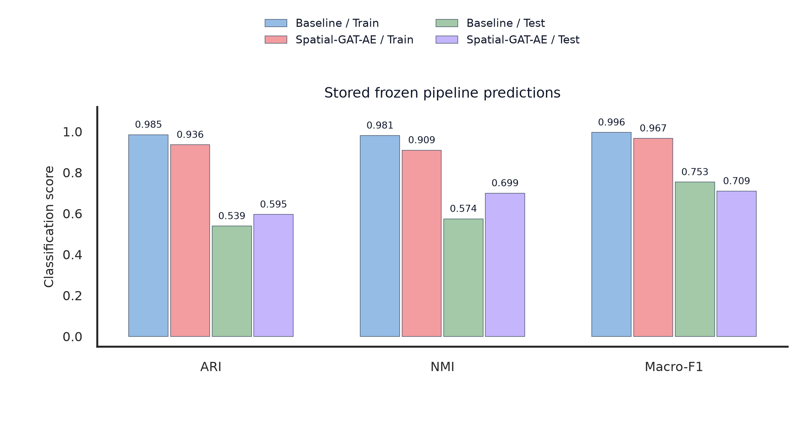
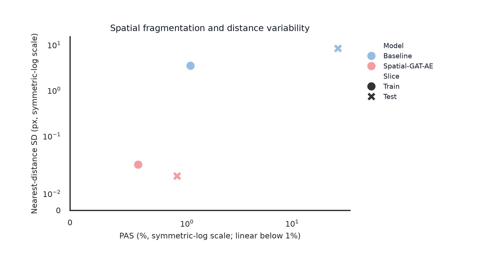
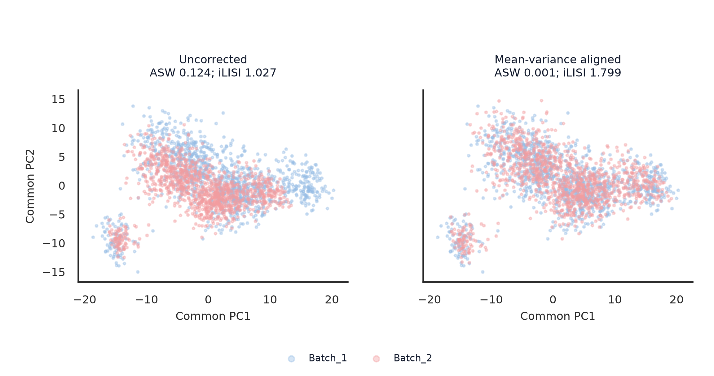

# SpatialCytoScope 科学评估报告

## 数据与评估设计

随机种子 42。训练切片 1200 Spots；测试切片 1200 Spots。两个合成切片来自不同随机种子；Batch_2 额外含乘性偏移与背景噪声。

两切片共享固定六边形网格与几何结构域模板。独立性体现在计数、细胞比例采样和批次扰动；本实验没有验证新组织几何或真实患者切片的泛化。

本报告读取 Step 3 冻结预测，不训练或微调任何模型。训练分数为拟合内分数；测试分数来自独立切片的零样本预测。只有一对合成切片，不将 Spot 当作独立生物学重复，不报告跨切片置信区间或显著性。

独立性核验通过：训练与测试 Spot ID 不重叠、合成采样种子不同，两个切片的模型来源均记录为 slice_train。元数据核验提供可复查记录，并非对训练过程无泄漏的形式化证明。

- `slice_train.h5ad` SHA256：`e5421829130ac1420bbf5774e210f9956b50dd7e3803de850dc405d5fdda1317`
- `slice_test.h5ad` SHA256：`2b123c9f8c9115ff3bd0013186874f07d60e4227c73196a6082ebd36d57129c9`

## 分类、解卷积与空间连续性（原管线冻结输出）

| Slice | Model | N_spots | ARI | NMI | Macro_F1 | PAS | CHAOS_px | RMSE | Mean_Pearson_r | Cosine_similarity | Valid_Pearson_types |
| --- | --- | --- | --- | --- | --- | --- | --- | --- | --- | --- | --- |
| Train | Baseline | 1200 | 0.9849 | 0.9808 | 0.9960 | 0.0108 | 3.4504 | 0.0229 | 0.9740 | 0.9959 | 6.0000 |
| Train | Spatial-GAT-AE | 1200 | 0.9356 | 0.9092 | 0.9669 | 0.0058 | 0.0271 | 0.0794 | 0.6787 | 0.9445 | 6.0000 |
| Test | Baseline | 1200 | 0.5387 | 0.5742 | 0.7534 | 0.2733 | 8.2722 | 0.0644 | 0.7171 | 0.9626 | 6.0000 |
| Test | Spatial-GAT-AE | 1200 | 0.5953 | 0.6992 | 0.7093 | 0.0092 | 0.0203 | 0.0966 | 0.6722 | 0.9315 | 6.0000 |

Baseline 原管线的测试 PCA 与训练 PCA 分别拟合，坐标系不同。这张主表保留真实已存储输出；跨模型迁移优劣应同时查看下文的共享训练 PCA 对照。

Macro-F1 直接比较监督类别 ID，不事后重排标签。RMSE 汇总所有 Spot×6 类细胞；Pearson r 先在各细胞类型内跨 Spot 计算，再对有效类型等权平均；常量列相关性记为 NA 并排除。Cosine 为各 Spot 的六维向量余弦均值。

PAS 使用原始像素坐标的恰好 6 个近邻：至少 4 个标签不同即异常。表中为 0–1 比例。该定义与 Step 4 UI 使用对称 union-kNN 全部邻居的 PAS 不同，不能直接混用。

CHAOS_px 按本项目指定定义，取每个簇内最近邻距离的总体标准差，再对至少 2 个 Spot 的簇等权平均；单例簇不计。它是最近邻距离变异指标，不是标准 CHAOS 的平均最近邻距离定义。均匀但分散的簇也可得到低值，应结合 PAS 与分型指标解读。

## 分细胞类型解卷积

| Slice | Model | Cell_type | RMSE | Pearson_r |
| --- | --- | --- | --- | --- |
| Train | Baseline | T_cell | 0.0229 | 0.9755 |
| Train | Baseline | B_cell | 0.0206 | 0.9797 |
| Train | Baseline | Macrophage | 0.0265 | 0.9801 |
| Train | Baseline | NK_cell | 0.0170 | 0.9573 |
| Train | Baseline | Dendritic | 0.0197 | 0.9571 |
| Train | Baseline | Tumor_Epi | 0.0288 | 0.9944 |
| Train | Spatial-GAT-AE | T_cell | 0.0802 | 0.6309 |
| Train | Spatial-GAT-AE | B_cell | 0.0639 | 0.8153 |
| Train | Spatial-GAT-AE | Macrophage | 0.0860 | 0.8070 |
| Train | Spatial-GAT-AE | NK_cell | 0.0532 | 0.4247 |
| Train | Spatial-GAT-AE | Dendritic | 0.0584 | 0.5013 |
| Train | Spatial-GAT-AE | Tumor_Epi | 0.1170 | 0.8930 |
| Test | Baseline | T_cell | 0.1047 | 0.3798 |
| Test | Baseline | B_cell | 0.0376 | 0.9478 |
| Test | Baseline | Macrophage | 0.0408 | 0.9751 |
| Test | Baseline | NK_cell | 0.0307 | 0.8646 |
| Test | Baseline | Dendritic | 0.0754 | 0.1470 |
| Test | Baseline | Tumor_Epi | 0.0652 | 0.9886 |
| Test | Spatial-GAT-AE | T_cell | 0.0933 | 0.6309 |
| Test | Spatial-GAT-AE | B_cell | 0.0762 | 0.7843 |
| Test | Spatial-GAT-AE | Macrophage | 0.0807 | 0.8397 |
| Test | Spatial-GAT-AE | NK_cell | 0.0539 | 0.4064 |
| Test | Spatial-GAT-AE | Dendritic | 0.0588 | 0.4766 |
| Test | Spatial-GAT-AE | Tumor_Epi | 0.1690 | 0.8951 |

## 跨批次特征分布

| Batch_ASW | Batch_ASW_mixing | iLISI | Method | Domain_ASW | Within_domain_Batch_ASW | N_common_genes |
| --- | --- | --- | --- | --- | --- | --- |
| 0.1238 | 0.8583 | 1.0265 | Uncorrected | 0.1353 | 0.2066 | 800 |
| 0.0011 | 0.9608 | 1.7994 | Mean-variance aligned | 0.1670 | 0.0033 | 800 |

先按共享基因顺序合并 log1p 标准化表达，拟合一个共同 30 维 PCA；校正前后均投影到这套固定基底。没有直接拼接两个独立 PCA 坐标系。

校正采用均值方差对齐：以 Batch_1 为参考，将 Batch_2 各基因的均值和总体标准差对齐。该方法不是 ComBat。估计 Batch_2 矩使用其全部无标签特征，因此属于转导式批次诊断，不是冻结模型的零样本校正收益。

Batch_ASW 为批次标签的平均有符号 silhouette；Batch_ASW_mixing 为 mean(1−|silhouette|)，越高表示混合更充分。iLISI 使用欧氏近邻、Gaussian 熵匹配（perplexity=30，最多 90 个邻居，不含自身）、批次概率的逆 Simpson 指数均值，两批次范围 [1,2]。非官方整合基准软件输出，未做额外归一化。

Domain_ASW 检查生物结构域分离度；Within_domain_Batch_ASW 是各真实结构域内批次 silhouette 按 Spot 数加权的均值。混合指标改善并不自动代表生物信号保持。

## 零样本性能保持率

| Model | Metric | Train | Test | Retention_pct |
| --- | --- | --- | --- | --- |
| Baseline | ARI | 0.9849 | 0.5387 | 54.6950 |
| Baseline | NMI | 0.9808 | 0.5742 | 58.5454 |
| Baseline | Macro_F1 | 0.9960 | 0.7534 | 75.6473 |
| Baseline | RMSE | 0.0229 | 0.0644 | 35.5861 |
| Baseline | Mean_Pearson_r | 0.9740 | 0.7171 | 73.6288 |
| Baseline | Cosine_similarity | 0.9959 | 0.9626 | 96.6606 |
| Spatial-GAT-AE | ARI | 0.9356 | 0.5953 | 63.6316 |
| Spatial-GAT-AE | NMI | 0.9092 | 0.6992 | 76.9053 |
| Spatial-GAT-AE | Macro_F1 | 0.9669 | 0.7093 | 73.3519 |
| Spatial-GAT-AE | RMSE | 0.0794 | 0.0966 | 82.2321 |
| Spatial-GAT-AE | Mean_Pearson_r | 0.6787 | 0.6722 | 99.0385 |
| Spatial-GAT-AE | Cosine_similarity | 0.9445 | 0.9315 | 98.6232 |

ARI/NMI/Macro-F1/Pearson/Cosine 使用 Test÷Train×100%；RMSE 使用 Train÷Test×100%，使越高均表示更好的保持。非正训练分数或无效分母记 NA；不截断超过 100% 的比率。这里只量化冻结模型，不把均值方差对齐后的诊断特征用于重新训练。

## 误差分析

- Baseline：独立测试 ARI=0.5387，Macro-F1=0.7534，RMSE=0.0644；PAS=27.33%。

- Spatial-GAT-AE：独立测试 ARI=0.5953，Macro-F1=0.7093，RMSE=0.0966；PAS=0.92%。

测试切片 Spatial-GAT 相对原 Baseline：ARI 差值 +0.0566，Macro-F1 差值 -0.0442，RMSE 差值 +0.0321（RMSE 越低越好）。空间连续性与监督任务精度应分别判断。

### Baseline 的 PCA 坐标系诊断

| Slice | Model | N_spots | ARI | NMI | Macro_F1 | PAS | CHAOS_px | RMSE | Mean_Pearson_r | Cosine_similarity | Valid_Pearson_types |
| --- | --- | --- | --- | --- | --- | --- | --- | --- | --- | --- | --- |
| Test_shared_train_PCA | Baseline | 1200 | 0.6215 | 0.6651 | 0.8088 | 0.1783 | 5.2034 | 0.0432 | 0.9677 | 0.9899 | 6.0000 |

原始测试 Baseline ARI=0.5387；测试表达改投影到冻结训练 PCA 后，ARI=0.6215。该附加分析不修改原 H5AD，不重新拟合 RandomForest/Ridge，也不使用测试标签进行映射或调参；它区分特征坐标漂移与模型自身迁移误差。主表保留原管线的实际输出。

### 最多见的跨域误判

| Slice | Model | True_domain | Predicted_domain | N_errors |
| --- | --- | --- | --- | --- |
| Test | Spatial-GAT-AE | 0 | 4 | 177 |
| Test | Baseline | 1 | 3 | 83 |
| Test | Baseline | 3 | 1 | 73 |
| Test | Baseline | 1 | 4 | 63 |
| Test | Spatial-GAT-AE | 1 | 4 | 27 |
| Test | Spatial-GAT-AE | 2 | 4 | 17 |
| Train | Spatial-GAT-AE | 0 | 1 | 16 |
| Train | Spatial-GAT-AE | 1 | 3 | 6 |
| Train | Spatial-GAT-AE | 3 | 1 | 5 |
| Train | Baseline | 4 | 0 | 3 |
| Train | Baseline | 4 | 1 | 3 |

真实测试标签仅用于最终打分和误差分组。结构边界 Spot 的细胞混合、组织区域重叠及 Batch_2 特征偏移共同影响跨切片预测；当前设计没有独立改变每个因素，不能单独归因。

## 图表与复现

所有图由实际 CSV 表和共同 PCA 特征生成；无模拟误差条。PNG 为 320 dpi，PDF 保留可编辑文字。

项目根目录执行 `python -m src.evaluation`，再执行 `python -m pytest -q tests/test_pipeline.py`。源表位于 docs/figures/*.csv。
